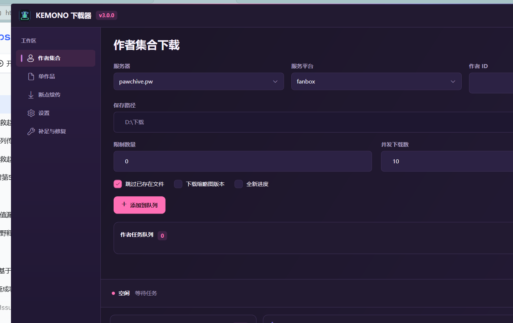
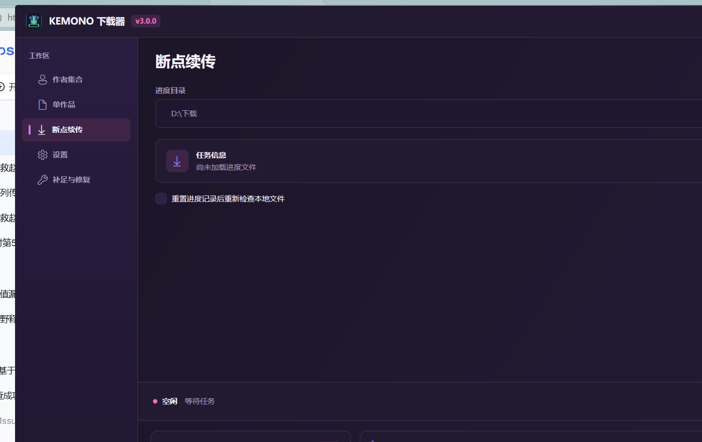
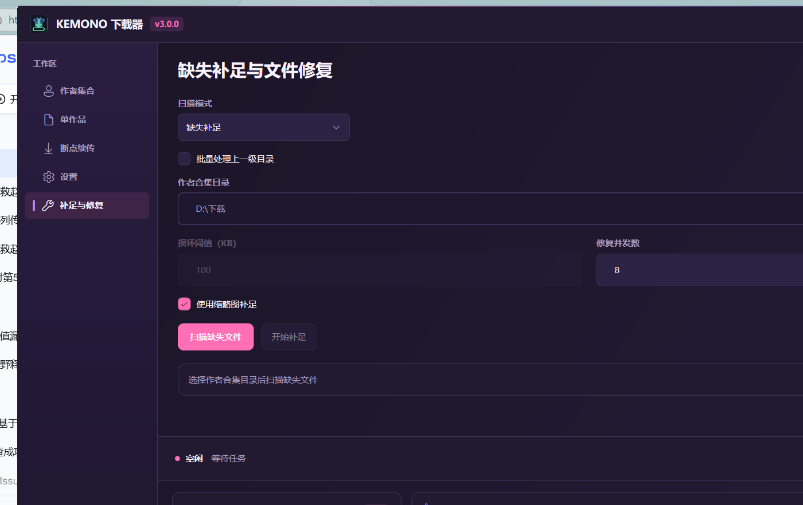
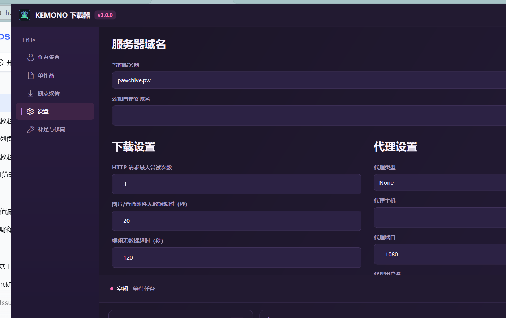

# Kemono Downloader v3.0.0

[简体中文](README.md) | **English**

A Windows desktop downloader built on .NET 10 and native WPF. The project has been fully migrated from Electron/Node.js to C# and no longer requires a Node runtime.

For detailed release information, see the [3.0.0 release notes](UPDATE_NOTICE_3.0.0.md) (in Chinese).



## Table of Contents

- [Getting Started](#getting-started)
- [Field Examples](#field-examples)
- [Single Post Downloads](#single-post-downloads)
- [Resuming Downloads](#resuming-downloads)
- [Missing Files and Repair](#missing-files-and-repair)
- [Settings](#settings)
- [Features](#features)
- [System Requirements](#system-requirements)
- [Development](#development)
- [Publishing](#publishing)
  - [Prerequisites](#prerequisites)
  - [Build Command](#build-command)
  - [Output and Distribution](#output-and-distribution)
  - [Troubleshooting](#troubleshooting)
- [Download Directory Layout](#download-directory-layout)
- [Project Structure](#project-structure)
- [Settings Files](#settings-files)
- [Disclaimer](#disclaimer)
- [License](#license)

## Getting Started

### Ways to Run

Pick either:

- **Prebuilt build (recommended)**: unzip the release package and double-click `KemonoDownloader.exe`. It is a self-contained single file for win-x64, so no separate .NET Desktop Runtime installation is required.
- **Run from source**: install .NET SDK 10.0.400, then run this from the repository root:

```powershell
dotnet run --project src\KemonoDownloader.Wpf\KemonoDownloader.Wpf.csproj
```

### First Run

1. Open the "作者集合" (Author Collection) page on the left.
2. Pick a site under "服务器" (Server); the default is `kemono.cr`.
3. Pick the author's platform under "服务平台" (Service); the default is `fanbox`.
4. Enter the author ID under "作者 ID" (Author ID), for example `123456`.
5. Click the folder button next to "保存路径" (Save Path) and choose the download root.
6. Click "添加到队列" (Add to Queue). The task starts immediately when the queue is idle; otherwise it is appended and runs after the current task finishes.

The "开始下载" (Start Download) button at the bottom performs the same enqueue action on the Author Collection page, and starts the task directly on the other pages. "继续队列" (Resume Queue) only appears after you stop the queue manually.

## Field Examples

The table below uses the Author Collection page; field names match the UI:

| Field | Example | Default | Notes |
| --- | --- | --- | --- |
| Server | `kemono.cr` | `kemono.cr` | Built in: `kemono.cr`, `kemono.su`, `pawchive.pw`; add custom domains on the Settings page |
| Service | `fanbox` | `fanbox` | One of `fanbox`, `patreon`, `fantia`, `subscribestar`, `gumroad`, `discord` |
| Author ID | `123456` | empty | The numeric segment after `/user/` in `https://kemono.cr/fanbox/user/123456` |
| Save path | `D:\Kemono` | empty | Required. Posts are written to `<save path>\<author name>\` |
| Limit | `0` | `0` | `0` scrapes every post; a positive number caps the number of posts |
| Concurrency | `5` | `5` | Allowed 1–20; out-of-range values are rejected on start with a log message |
| Skip existing files | checked | checked | Files already present are not downloaded again |
| Download thumbnail version | unchecked | unchecked | Uses thumbnail URLs instead of originals |
| Fresh progress | unchecked | unchecked | Ignores the existing `download_progress.json` and starts a new progress record |

The defaults above are the values shown on first launch. They come from `%AppData%/KemonoDownloader/settings.json` (concurrency, "Skip existing files by default", and similar are driven by the Settings page), so changing settings changes the initial values for new tasks. Each download page also remembers its last inputs and restores them on restart; the UI and the Settings page always win.

## Single Post Downloads

Switch to the "单作品" (Single Post) page, paste the post URL into "作品链接" (Post URL), choose a save path, then click "开始下载" (Start Download) at the bottom.

Example link:

```text
https://kemono.cr/fanbox/user/123456/post/7890123
```

The URL must be the five-segment path `/<service>/user/<userId>/post/<postId>`; extra prefixes or missing segments are rejected. Site home pages and author pages do not match that shape and fail with:

```text
作品链接格式必须为 /<service>/user/<userId>/post/<postId>。
```

Query parameters and trailing slashes are ignored; the task requests the normalized `https://<domain>/<service>/user/<userId>/post/<postId>` address.

Other fields:

- The domain must be one of the domains listed on the Settings page, otherwise the app reports `请输入有效的 Kemono 作品链接。`.
- Except for `pawchive.pw`, the requested domain is replaced with the current server from the Settings page; the domain in the post URL is only used to parse the path.
- Save path, concurrency, "Skip existing files", "Download thumbnail version", and "Fresh progress" behave exactly as on the Author Collection page.

## Resuming Downloads

1. Stop the task manually, or close the app while a download is interrupted.
2. Reopen the app and switch to the "断点续传" (Resume) page.
3. Click the folder button next to "进度目录" (Progress directory) and select the author directory that contains `download_progress.json`.
4. Check the platform, author, and completed post count shown under "任务信息" (Task info).
5. To ignore the old record and re-check local files only, tick "重置进度记录后重新检查本地文件" (Reset progress record and re-check local files).
6. Click "开始下载" (Start Download) at the bottom.

Notes:

- The progress file is `download_progress.json` inside the author directory. Unfinished attachments are kept as `.part` and `.part.meta.json` in the post directory and resumed via HTTP Range.
- A resumed task uses the current server domain from the Settings page; the save root is derived from the parent of the selected author directory, so it never falls back to a path configured on another page.
- Ticking "重置进度记录后重新检查本地文件" is equivalent to starting the task with "Fresh progress"; whether existing files are downloaded again depends on "Skip existing files".



## Missing Files and Repair

1. Switch to the "补足与修复" (Backfill and Repair) page.
2. Choose "缺失补足" (Missing backfill) or "损坏修复" (Corruption repair) under "扫描模式" (Scan mode).
3. Select a directory: a single author directory by default; tick "批量处理上一级目录" (Batch process parent directory) to select a parent folder containing several author directories and process them one by one.
4. Click "扫描缺失文件" / "扫描损坏文件" (Scan missing / corrupted files); batch mode prefixes the button with "批量" (Batch). Wait for the scan to finish.
5. In missing mode you can click "查看缺失文件" (View missing files) to expand results grouped by post and verify sequential file names and original attachment names.
6. Adjust "损坏阈值（KB）" (Corruption threshold in KB, default 100, corruption repair only) and "修复并发数" (Repair concurrency, default 5) as needed; in missing mode you can tick "使用缩略图补足" (Backfill with thumbnails).
7. Click "开始补足" / "开始修复" (Start backfill / Start repair), shown as "批量补足" / "批量修复" in batch mode.



## Settings

The Settings page is split into server domains, download settings, and proxy settings. Click "保存设置" (Save settings) to apply; click "恢复默认" (Restore defaults) and confirm in the dialog to revert to built-in values. Out-of-range values raise `设置参数超出允许范围。` and are not saved.

| Field | Default | Allowed range | Notes |
| --- | --- | --- | --- |
| Current server | `kemono.cr` | domain list | Site used by new tasks |
| Add custom domain | empty | valid host name | Enter, then click "添加域名" (Add domain) to add third-party Kemono sites |
| Max HTTP request attempts | 3 | 1–20 | Retry cap per request |
| Image/regular attachment no-data timeout (s) | 60 | 10–3600 | Ends the current attempt after this long without data |
| Video no-data timeout (s) | 120 | 30–7200 | Same as above, relaxed for video |
| Page request interval (ms) | 1500 | 500–5000 | Delay between paginated requests to avoid rate limits |
| Default concurrency | 5 | 1–20 | Initial concurrency for new tasks on every download page |
| Post enqueue interval (ms) | 500 | 0–5000 | Delay between queued posts |
| Skip existing files by default | checked | checked/unchecked | Initial checkbox state on every download page |
| Advanced download timeouts · Response header timeout (s) | 30 | 5–300 | Upper bound for waiting on response headers |
| Advanced download timeouts · Minimum sustained speed (KiB/s) | 8 | 1–1024 | Falling below this across the window counts as low speed |
| Advanced download timeouts · Low-speed window (s) | 300 | 30–3600 | Statistics window for low-speed detection |
| Advanced download timeouts · Max total duration (h) | 24 | 1–24 | Dynamic hard cap |
| Proxy type | `None` | `None` / `Http` / `Https` / `Socks5` | Host and port are required for any non-`None` type |
| Proxy host / proxy port | empty / 1080 | port 1–65535 | Proxy password is encrypted per user with Windows DPAPI |



## Features

- Author collection downloads supporting Fanbox, Patreon, Fantia, SubscribeStar, Gumroad, and Discord
- Author download task queue — queue new tasks by server and author ID while the current one is running, with resolved author names displayed
- Single post link downloads
- Paginated scraping, quantity limits, and raw JSON data saving
- Configurable concurrency, post enqueue interval, and maximum download attempts (default: 3)
- Cross-post rolling download pool — idle slots are immediately refilled with new attachments
- Adaptive attachment timeouts: response headers, consecutive data stalls, sustained low speed, and dynamic total duration are evaluated separately
- HTTP Range resume across retries and application restarts, retaining `.part` and `.part.meta.json`
- Adaptive concurrency reduction and recovery on HTTP 429
- HTTP, HTTPS, and SOCKS5 proxies with proxy authentication
- Server domain switching with built-in `kemono.cr`, `kemono.su`, and `pawchive.pw`, plus support for custom domains
- Compatible with Kemono/Pawchive author profile fields; legacy `user_<ID>` directories are automatically migrated to author names
- Thumbnail download mode
- Automatic incremental downloads for new tasks and task progress resume
- Resume state is always written back to the selected author directory, unaffected by save paths configured on other pages
- Content-Length validation, error response type detection, and atomic writes
- Corrupted file scanning and re-downloading
- Missing attachment scanning and backfill, with an option to substitute thumbnails when originals are unavailable
- Missing scan results grouped by post, expandable to inspect specific sequential files and original attachment names
- Batch scanning of the parent directory of author collections, performing missing backfill or corruption repair author by author
- Real-time progress, structured logging, and safe stop
- Window position and size memory
- Automatic memory of servers, save directories, and recent configurations for each download page

## System Requirements

- Windows 10 or later (the publish profile only targets win-x64)
- Development environment: .NET SDK 10.0.400 or a compatible .NET 10 SDK

The published self-contained build does not require users to install the .NET Desktop Runtime separately.

## Development

```powershell
dotnet restore KemonoDownloader.slnx
dotnet build KemonoDownloader.slnx
dotnet test tests\KemonoDownloader.Tests\KemonoDownloader.Tests.csproj
dotnet run --project src\KemonoDownloader.Wpf\KemonoDownloader.Wpf.csproj
```

## Publishing

### Prerequisites

- Windows 10 or later; the publish profile fixes `RuntimeIdentifier` to `win-x64`.
- Install .NET SDK 10.0.400. The repository's `global.json` pins that version with `rollForward: latestPatch`, so a later 10.0.4xx patch release also works.
- The first restore needs NuGet access. Run `dotnet --list-sdks` to confirm the SDK is available.

### Build Command

From the repository root:

```powershell
dotnet publish src\KemonoDownloader.Wpf\KemonoDownloader.Wpf.csproj `
  -c Release `
  -p:PublishProfile=win-x64
```

- `-p:PublishProfile=win-x64` loads `src\KemonoDownloader.Wpf\Properties\PublishProfiles\win-x64.pubxml`, which fixes `Configuration=Release`, `RuntimeIdentifier=win-x64`, `SelfContained=true`, `PublishSingleFile=true`, `IncludeNativeLibrariesForSelfExtract=true`, `EnableCompressionInSingleFile=true`, and `PublishTrimmed=false`.
- `-c Release` matches the profile and makes the command self-explanatory; `Directory.Build.props` disables debug symbols in Release.

### Output and Distribution

Output goes to `artifacts\publish\win-x64\` (the profile's `PublishDir`), and the main artifact is a single file:

```text
artifacts\publish\win-x64\KemonoDownloader.exe
```

- The file name comes from `AssemblyName=KemonoDownloader`, and the icon from `ApplicationIcon=..\..\assets\app-icon.ico`.
- Self-contained and single-file, so target machines need no .NET Desktop Runtime; you can rename, compress, or copy it freely.
- Trimming (`PublishTrimmed=false`) and ReadyToRun are disabled, so the first launch is slower than later ones.
- Native libraries are embedded in the single file, so the first run extracts them to the current user's temp directory. That is expected; do not ship only the extracted temp files.

### Troubleshooting

- `dotnet` is not recognized: the SDK is missing or older than `global.json` requires; install .NET SDK 10.0.400 and retry.
- Forgot `-p:PublishProfile=win-x64`: output lands in `bin\Release\net10.0-windows\publish\` as a framework-dependent multi-file build that needs the .NET Desktop Runtime on the target machine.
- Mixed files from a previous publish: delete `artifacts\publish\win-x64\` and publish again.
- Antivirus flags the single file: add it to an allow list, or build from source.
- Other architectures: only win-x64 is provided. Add another `PublishProfile` and change `RuntimeIdentifier` yourself, keeping in mind that WPF is Windows-only.

## Download Directory Layout

```text
<Save path>/<Author name>/
├── download_progress.json
├── json/
│   ├── 1.json
│   └── post_<postId>.json
└── src/
    └── <Publish date> <Post title>/
        ├── 1.jpg
        └── 2.png
```

Progress files use `schema_version: 2`. Progress files generated by the legacy Electron version are not overwritten; the app will show a notification that their format is unsupported — please create a new task for the WPF version.

Posts with an empty title fall back to `post_<postId>`, and posts with an empty date fall back to `unknown`.

## Project Structure

```text
src/
├── KemonoDownloader.Core/            # Models, rules, and shared interfaces
├── KemonoDownloader.Infrastructure/  # HTTP, proxies, downloads, progress, settings, and repair
└── KemonoDownloader.Wpf/             # WPF UI and MVVM
tests/
└── KemonoDownloader.Tests/           # xUnit unit and integration tests
```

## Settings Files

- `%AppData%/KemonoDownloader/settings.json`
- `%AppData%/KemonoDownloader/window-state.json`

Proxy passwords are encrypted per user with Windows DPAPI.

By default, attachment downloads wait 30 seconds for response headers; images and regular attachments end the current attempt after 60 consecutive seconds without data, and videos after 120 seconds. Transferring files are no longer subject to a fixed total duration limit; sustained low-speed thresholds and the dynamic hard cap can be adjusted under "Advanced Download Timeouts" on the settings page.

## Disclaimer

This project is for learning and research purposes only. Users must comply with the terms of service of the target websites, applicable local laws, and content copyright requirements, and assume all risks of use.

## License

[MIT](LICENSE)
