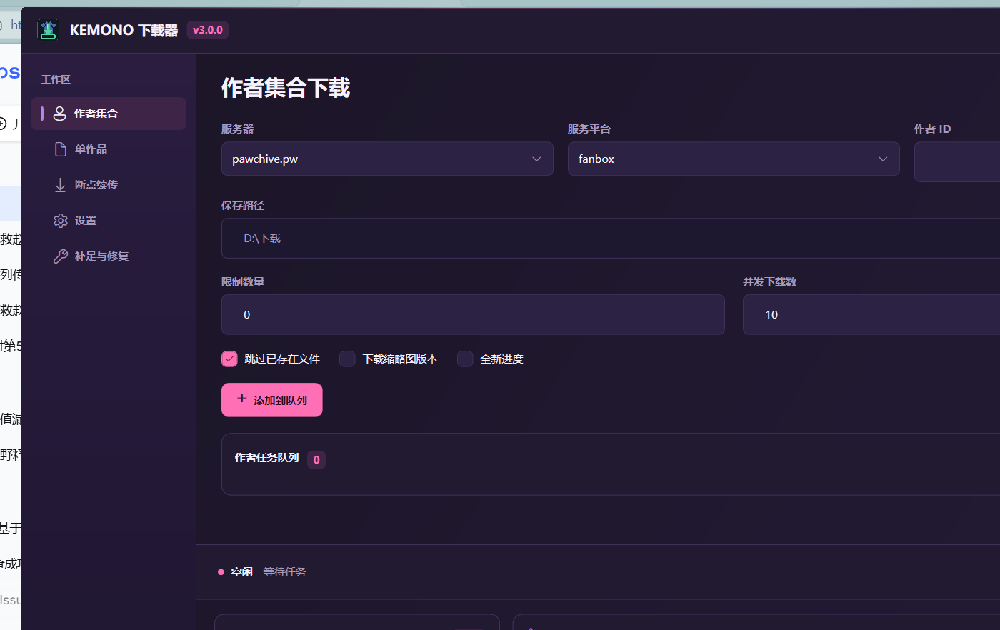
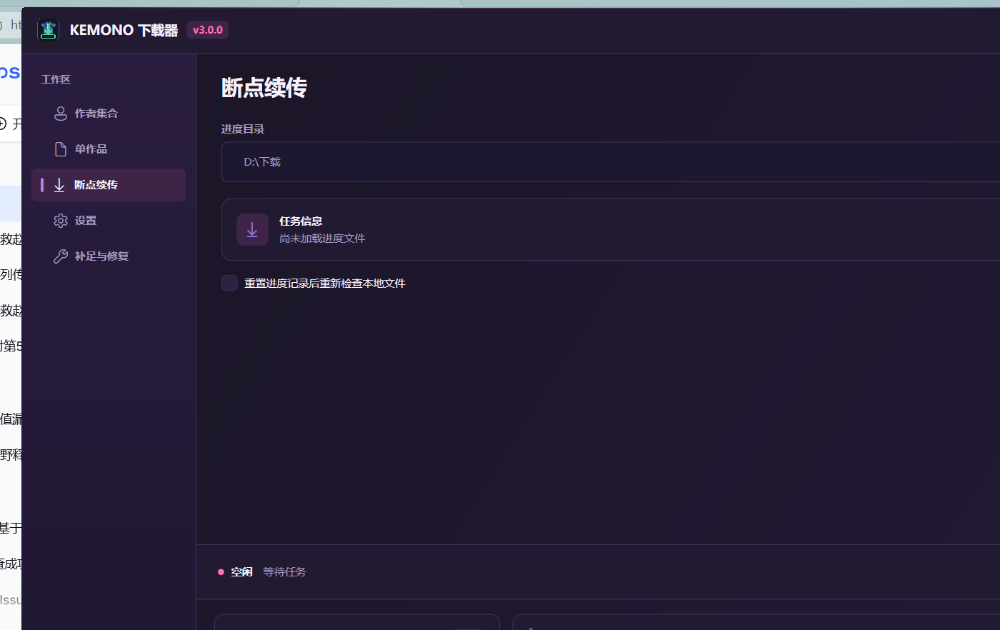
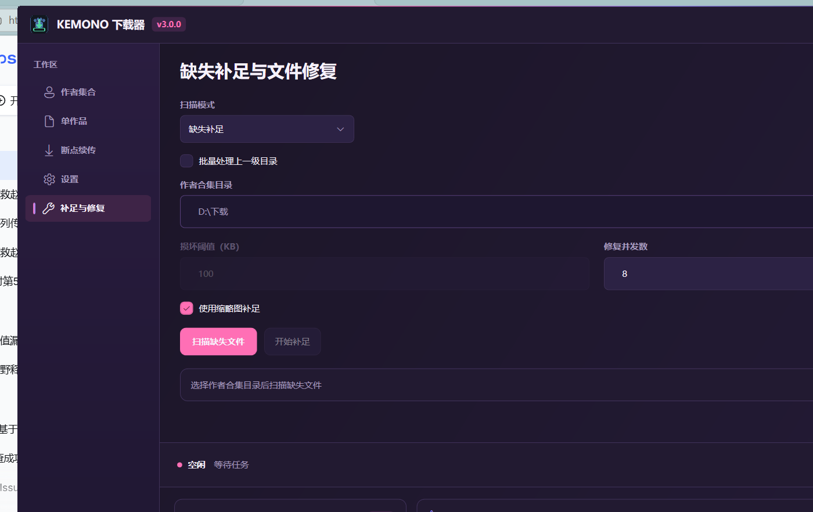
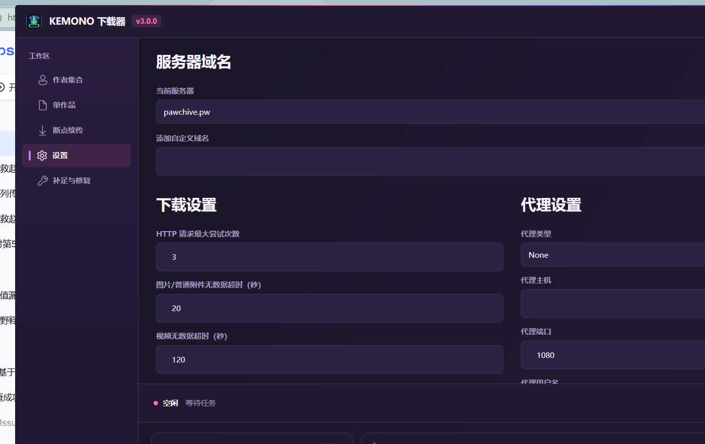

# Kemono 下载器 v3.0.0

**简体中文** | [English](README.en.md)

基于 .NET 10 和原生 WPF 的 Windows 桌面下载器。项目已从 Electron/Node.js 完整迁移到 C#，不再需要 Node 运行时。

详细更新内容请参阅 [3.0.0 更新公告](UPDATE_NOTICE_3.0.0.md)。



## 目录

- [快速开始](#快速开始)
- [填写示例](#填写示例)
- [单作品下载](#单作品下载)
- [断点续传](#断点续传)
- [缺失补足与文件修复](#缺失补足与文件修复)
- [设置](#设置)
- [功能](#功能)
- [系统要求](#系统要求)
- [开发](#开发)
- [发布](#发布)
  - [环境准备](#环境准备)
  - [打包命令](#打包命令)
  - [产物与分发](#产物与分发)
  - [常见问题](#常见问题)
- [下载目录](#下载目录)
- [项目结构](#项目结构)
- [设置文件](#设置文件)
- [免责声明](#免责声明)
- [License](#license)

## 快速开始

### 运行方式

两种方式任选其一：

- **绿色版（推荐）**：解压发布包，双击 `KemonoDownloader.exe`。该版本是 win-x64 自包含单文件，不需要另外安装 .NET Desktop Runtime。
- **源码运行**：安装 .NET SDK 10.0.400 后，在仓库根目录执行：

```powershell
dotnet run --project src\KemonoDownloader.Wpf\KemonoDownloader.Wpf.csproj
```

### 上手步骤

1. 打开左侧「作者集合」页。
2. 在「服务器」中选择要请求的站点，默认 `kemono.cr`。
3. 在「服务平台」中选择作者所在的平台，默认 `fanbox`。
4. 在「作者 ID」中填入作者 ID，例如 `123456`。
5. 点击「保存路径」右侧的文件夹按钮，选择下载根目录。
6. 点击「添加到队列」。队列空闲时任务立即开始；已有任务在跑时新任务排在队尾，当前任务结束后自动继续。

底部的「开始下载」在「作者集合」页执行同样的入队动作；在其它页面则直接启动该页面的任务。「继续队列」只在手动停止之后出现。

## 填写示例

下表以「作者集合」页为例，字段名与界面一致：

| 字段 | 示例值 | 默认值 | 说明 |
| --- | --- | --- | --- |
| 服务器 | `kemono.cr` | `kemono.cr` | 内置 `kemono.cr`、`kemono.su`、`pawchive.pw`，自定义域名在「设置」页添加 |
| 服务平台 | `fanbox` | `fanbox` | 可选 `fanbox`、`patreon`、`fantia`、`subscribestar`、`gumroad`、`discord` |
| 作者 ID | `123456` | 空 | 取自作者主页地址 `https://kemono.cr/fanbox/user/123456` 中 `/user/` 之后的数字段 |
| 保存路径 | `D:\Kemono` | 空 | 必填。作品会写入 `<保存路径>\<作者名>\` |
| 限制数量 | `0` | `0` | `0` 表示抓取全部作品，填正整数则最多抓取该数量的作品 |
| 并发下载数 | `5` | `5` | 允许 1–20，超过范围会在日志中报错并拒绝启动 |
| 跳过已存在文件 | 勾选 | 勾选 | 本地已有同名文件时不再重复下载 |
| 下载缩略图版本 | 不勾选 | 不勾选 | 勾选后改用缩略图地址下载 |
| 全新进度 | 不勾选 | 不勾选 | 勾选后忽略已有的 `download_progress.json`，从头建立进度 |

表中的默认值取首次启动时的界面值；这些值来自 `%AppData%/KemonoDownloader/settings.json`（并发数、「默认跳过已存在文件」等由设置页决定），修改设置后新建任务的初始值会随之改变。各下载页还会记忆上次的输入，重启后优先恢复上次的值；一切以界面与「设置」页当前显示为准。

## 单作品下载

在左侧切换到「单作品」页，把作品地址填入「作品链接」，再选择保存路径，最后点底部「开始下载」。

示例链接：

```text
https://kemono.cr/fanbox/user/123456/post/7890123
```

链接必须是 `/<service>/user/<userId>/post/<postId>` 这五段路径，多余的前缀或缺失的段都会报错。站点首页、作者主页这类不满足五段格式的地址会被拒绝，日志会显示：

```text
作品链接格式必须为 /<service>/user/<userId>/post/<postId>。
```

链接中的查询参数与末尾斜杠会被忽略，任务使用规范化后的 `https://<域名>/<service>/user/<userId>/post/<postId>` 作为请求地址。

其它字段：

- 域名必须是「设置」页可选列表中的域名，否则提示「请输入有效的 Kemono 作品链接。」。
- 除 `pawchive.pw` 外，任务实际请求的域名会替换为「设置」页的当前服务器，作品地址中的域名只用于识别路径。
- 保存路径、并发下载数、「跳过已存在文件」「下载缩略图版本」「全新进度」的含义与「作者集合」页一致。

## 断点续传

1. 手动停止或在下载中断后关闭软件。
2. 重新打开软件，切换到「断点续传」页。
3. 点击「进度目录」右侧的文件夹按钮，选择作者目录（其中包含 `download_progress.json`）。
4. 核对「任务信息」中显示的平台、作者与已完成作品数。
5. 需要忽略旧记录、只按本地文件重新检查时，勾选「重置进度记录后重新检查本地文件」。
6. 点击底部「开始下载」。

说明：

- 进度文件为作者目录下的 `download_progress.json`，未完成的附件以 `.part` 与 `.part.meta.json` 保留在作品目录中，续传使用 HTTP Range。
- 续传任务使用「设置」页当前的服务器域名，保存根目录由所选作者目录的上一级推导，因此不会落到其它页面配置的路径。
- 勾选「重置进度记录后重新检查本地文件」等同于以「全新进度」启动该任务，已下载文件是否重下取决于「跳过已存在文件」。



## 缺失补足与文件修复

1. 切换到「补足与修复」页。
2. 在「扫描模式」中选择「缺失补足」或「损坏修复」。
3. 选择目录：默认扫描单个作者目录；勾选「批量处理上一级目录」后选择包含多个作者目录的父目录，逐个作者执行。
4. 点击「扫描缺失文件」/「扫描损坏文件」（批量模式下按钮文字带「批量」前缀），等待扫描完成。
5. 缺失模式下可点击「查看缺失文件」，按作品分组展开，核对顺序文件名和原始附件名。
6. 按需调整「损坏阈值（KB）」（默认 100，仅损坏修复可用）与「修复并发数」（默认 5），缺失模式下可勾选「使用缩略图补足」。
7. 点击「开始补足」/「开始修复」（批量模式下为「批量补足」/「批量修复」）。



## 设置

「设置」页分为服务器域名、下载设置、代理设置三块。改完点「保存设置」生效；点「恢复默认」并在确认框中确认后回到内置默认值；参数超出允许范围时会提示「设置参数超出允许范围。」且不会写入配置。

| 字段 | 默认值 | 允许范围 | 说明 |
| --- | --- | --- | --- |
| 当前服务器 | `kemono.cr` | 域名列表 | 新建任务使用的站点 |
| 添加自定义域名 | 空 | 合法主机名 | 填写后点「添加域名」，第三方 Kemono 站点也可加入列表 |
| HTTP 请求最大尝试次数 | 3 | 1–20 | 单个请求的最大重试次数 |
| 图片/普通附件无数据超时（秒） | 60 | 10–3600 | 连续无数据超过该时长结束当前尝试 |
| 视频无数据超时（秒） | 120 | 30–7200 | 同上，视频单独放宽 |
| 页面请求间隔（毫秒） | 1500 | 500–5000 | 分页请求之间的等待，避免触发限流 |
| 默认并发数 | 5 | 1–20 | 各下载页新建任务的初始并发 |
| 作品入队间隔（毫秒） | 500 | 0–5000 | 作品之间的排队间隔 |
| 默认跳过已存在文件 | 勾选 | 勾选/取消 | 影响各下载页的初始勾选状态 |
| 高级下载超时 · 响应头超时（秒） | 30 | 5–300 | 等待响应头的上限 |
| 高级下载超时 · 最低持续速度（KiB/s） | 8 | 1–1024 | 低于该速度累计到窗口时长即判定为低速 |
| 高级下载超时 · 低速判断窗口（秒） | 300 | 30–3600 | 低速判定的统计窗口 |
| 高级下载超时 · 最大总时长（小时） | 24 | 1–24 | 动态硬上限 |
| 代理类型 | `None` | `None` / `Http` / `Https` / `Socks5` | 选非 `None` 时必须填写主机与端口 |
| 代理主机 / 代理端口 | 空 / 1080 | 端口 1–65535 | 代理密码按当前用户用 Windows DPAPI 加密保存 |



## 功能

- 作者集合下载，支持 Fanbox、Patreon、Fantia、SubscribeStar、Gumroad 和 Discord
- 作者下载任务队列，可在当前任务运行时继续按服务器和作者 ID 排队，并显示解析后的作者名称
- 单作品链接下载
- 分页抓取、数量限制和原始 JSON 数据保存
- 可配置并发、作品入队间隔和最大下载尝试次数（默认 3 次）
- 跨作品滚动下载池，空闲槽位立即补入新附件
- 自适应附件超时：响应头、连续无数据、持续低速和动态总时长分别判定
- 跨重试与软件重启的 HTTP Range 断点续传，保留 `.part` 和 `.part.meta.json`
- HTTP 429 自适应降并发与恢复
- HTTP、HTTPS、SOCKS5 代理及代理认证
- 服务器域名切换，内置 `kemono.cr`、`kemono.su`、`pawchive.pw` 并支持自定义域名
- 兼容 Kemono/Pawchive 作者资料字段，旧 `user_<ID>` 目录可自动迁移为作者名称
- 缩略图下载模式
- 新任务自动增量下载和任务进度续传
- 断点续传始终写回所选作者目录，不受其他页面保存路径影响
- Content-Length 校验、错误响应类型识别和原子写入
- 损坏文件扫描与重新下载
- 缺失附件扫描与补足，可选使用缩略图替代无法获取的原图
- 缺失扫描结果按作品分组查看，可展开核对具体顺序文件和原始附件名
- 批量扫描作者合集上一级目录，并逐作者执行缺失补足或损坏修复
- 实时进度、结构化日志和安全停止
- 窗口位置与大小记忆
- 自动记忆服务器、保存目录和各下载页面的最近配置

## 系统要求

- Windows 10 或更高版本（发布配置仅提供 win-x64）
- 开发环境：.NET SDK 10.0.400 或兼容的 .NET 10 SDK

发布的自包含版本不要求用户另外安装 .NET Desktop Runtime。

## 开发

```powershell
dotnet restore KemonoDownloader.slnx
dotnet build KemonoDownloader.slnx
dotnet test tests\KemonoDownloader.Tests\KemonoDownloader.Tests.csproj
dotnet run --project src\KemonoDownloader.Wpf\KemonoDownloader.Wpf.csproj
```

## 发布

### 环境准备

- Windows 10 或更高版本，发布配置固定 `RuntimeIdentifier=win-x64`。
- 安装 .NET SDK 10.0.400。仓库根目录的 `global.json` 锁定该版本并设置 `rollForward: latestPatch`，因此装 10.0.4xx 的更高补丁版本也能通过。
- 首次还原需要能访问 NuGet。可用 `dotnet --list-sdks` 确认 SDK 已就绪。

### 打包命令

在仓库根目录执行：

```powershell
dotnet publish src\KemonoDownloader.Wpf\KemonoDownloader.Wpf.csproj `
  -c Release `
  -p:PublishProfile=win-x64
```

- `-p:PublishProfile=win-x64` 读取 `src\KemonoDownloader.Wpf\Properties\PublishProfiles\win-x64.pubxml`，其中已经固定 `Configuration=Release`、`RuntimeIdentifier=win-x64`、`SelfContained=true`、`PublishSingleFile=true`、`IncludeNativeLibrariesForSelfExtract=true`、`EnableCompressionInSingleFile=true`、`PublishTrimmed=false`。
- `-c Release` 与 profile 中的配置一致，显式写上便于命令本身自解释；`Directory.Build.props` 在 Release 下关闭调试符号。

### 产物与分发

输出目录为 `artifacts\publish\win-x64\`（来自 profile 的 `PublishDir`），主要产物是单个文件：

```text
artifacts\publish\win-x64\KemonoDownloader.exe
```

- 文件名来自 `AssemblyName=KemonoDownloader`，图标来自 `ApplicationIcon=..\..\assets\app-icon.ico`。
- 自包含 + 单文件，目标机器不需要安装 .NET Desktop Runtime，可以直接改名、压缩或拷贝分发。
- 没有启用裁剪（`PublishTrimmed=false`）和 ReadyToRun，首次启动会比再次启动慢一些。
- 单文件内含原生库，首次运行会解压到当前用户的临时目录，属于正常行为；不要只拷走运行中生成的临时文件。

### 常见问题

- `dotnet` 无法识别：未安装 SDK，或版本低于 `global.json` 的要求，安装 .NET SDK 10.0.400 后重试。
- 忘了 `-p:PublishProfile=win-x64`：产物会落在 `bin\Release\net10.0-windows\publish\` 且是多个文件的框架依赖版本，需要在目标机器装 .NET Desktop Runtime。
- 复用旧目录导致文件混杂：删除 `artifacts\publish\win-x64\` 后重新发布。
- 单文件被杀毒软件误报：加入白名单，或用源码自行构建。
- 需要其它架构：当前只提供 win-x64，其它架构需自行新增 `PublishProfile` 并修改 `RuntimeIdentifier`，同时注意 WPF 仅支持 Windows。

## 下载目录

```text
<保存路径>/<作者名>/
├── download_progress.json
├── json/
│   ├── 1.json
│   └── post_<postId>.json
└── src/
    └── <发布日期> <作品标题>/
        ├── 1.jpg
        └── 2.png
```

进度文件使用 `schema_version: 2`。Electron 旧版本生成的进度文件不会被覆盖，应用会提示其格式不受支持；请为 WPF 版本创建新任务。

标题为空的作品回退为 `post_<postId>`，日期为空时回退为 `unknown`。

## 项目结构

```text
src/
├── KemonoDownloader.Core/            # 模型、规则和公共接口
├── KemonoDownloader.Infrastructure/  # HTTP、代理、下载、进度、设置和修复
└── KemonoDownloader.Wpf/             # WPF 界面和 MVVM
tests/
└── KemonoDownloader.Tests/           # xUnit 单元和集成测试
```

## 设置文件

- `%AppData%/KemonoDownloader/settings.json`
- `%AppData%/KemonoDownloader/window-state.json`

代理密码通过 Windows DPAPI 按当前用户加密保存。

附件下载默认等待响应头 30 秒；图片和普通附件连续 60 秒无数据、视频连续 120 秒无数据时结束当前尝试。传输中的文件不再受固定总时长限制，持续低速与动态硬上限可在设置页的“高级下载超时”中调整。

## 免责声明

本项目仅供学习和研究使用。使用者应遵守目标网站的服务条款、当地法律及内容版权要求，并自行承担使用风险。

## License

[MIT](LICENSE)
